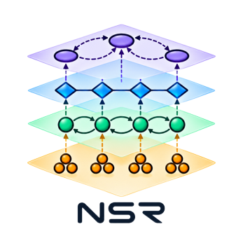

<div align="center">



# Neural Structural Reasoner

### A Brain-inspired Architecture for Reasoning over Structured Knowledge

**NeurIPS 2026 · Poster**

[Zixing Jia](https://horserunningwild.github.io/)<sup>1,2,3,4,*</sup> ·
Yuhang Pan<sup>1,2,3,*</sup> ·
[Ni Ji](https://cibr.ac.cn/teamDetail/cibrTeamteam/7eaf96c5b298444b84328680fb1b7a15/Ni%20Ji)<sup>1,2,3,†</sup>

<sup>* Equal contribution · † Corresponding author</sup>

**[Paper](https://arxiv.org/abs/2609.36620)** ·
**[Project](https://horserunningwild.github.io/NSR/project/)** ·
**[Interactive Blog](https://horserunningwild.github.io/NSR/)** ·
**[Video](https://horserunningwild.github.io/NSR/project/#presentation)** ·
**[Slides](https://horserunningwild.github.io/NSR/assets/neurips-slides.pptx)**

</div>

<details>
<summary>Author affiliations</summary>

1. Beijing Institute for Brain Research, Chinese Academy of Medical Sciences & Peking Union Medical College
2. Chinese Institute for Brain Research, Beijing
3. Beijing Key Laboratory of Brain Science and Brain-Machine Interface
4. Sun Yat-sen University

</details>

---

**NSR represents structured knowledge in neural connectivity and performs reasoning through network dynamics.** Dedicated populations represent entities, entity–relation bindings, relations, and their compositions. Local learning discovers relational structure, while the resulting inference paths can be inspected step by step.


*Conceptual overview: encode a fact, preserve its relational structure, and retrieve an entity through the network. This schematic illustrates the mechanism; it is not a recorded activation trace.*

- **Explicit structure.** Entities retain their identities, and facts are encoded as connections between entity–relation bindings.
- **Inspectable reasoning.** Relation associations and compositions support inference paths with identifiable intermediate entities and relations.
- **Efficient learning.** Local learning and an accelerated graph implementation provide competitive link prediction with low reported training times.

The [academic Project page](https://horserunningwild.github.io/NSR/project/) presents the method, experiments, and talk. The [interactive Blog](https://horserunningwild.github.io/NSR/) explores triple encoding and recorded neural dynamics through hands-on visualizations.

## Model at a glance

| Population | Represents | Biological inspiration |
| :-- | :-- | :-- |
| **E** | Entity identities | Hippocampus (HPC) |
| **Z** | Entity–directed-relation bindings | Entorhinal cortex (EC) |
| **R** | Relations and their inverses | Anterior temporal lobe (ATL) |
| **C** | Compositional relations | Prefrontal cortex (PFC) |

Given a triple `(h, r, t)`, NSR connects the corresponding R and Z neurons and writes bidirectional connections between `Z(h, r)` and `Z(t, r⁻¹)`. E–Z connections are fixed by the architecture. Subsequent learning estimates relation associations and compositional rules; a query `(h, r, ?)` produces scores over candidate tail entities.

These brain correspondences motivate the design; they are not a claim of biological equivalence. See the [paper](Neural_Structural_Reasoner.pdf) for the dynamics and learning equations, or try the [interactive encoding demo](https://horserunningwild.github.io/NSR/project/#method).

## Getting started

The core model runs on **CPU** and requires only **NumPy and SciPy**. Python **3.11** was used to verify the examples below. Run commands from the repository root.

```bash
git clone https://github.com/navbrainlab/Neural-Structural-Reasoner-NSR.git
cd Neural-Structural-Reasoner-NSR

python3.11 -m venv .venv
source .venv/bin/activate
python -m pip install numpy scipy
```

### Encode and query a small graph

Save the following as a Python script in the repository root, or paste it into a Python session started there:

```python
from NSR.NSR_Dynamic import NSRConfig, NSRDynamicERZC

entities = ["Paris", "France", "Europe"]
relations = ["capital_of", "located_in"]

model = NSRDynamicERZC(
    num_entities=len(entities),
    num_relations=len(relations),
    cfg=NSRConfig(),
)

# Each triple is (head_entity_id, relation_id, tail_entity_id).
triples = [(0, 0, 1), (1, 1, 2)]
model.encode_triples(triples)

# Query: (Paris, capital_of, ?)
scores = model.query(0, 0, use_C_layer=False)
print({entities[entity_id]: score for entity_id, score in scores.items()})
# {'France': 1.0}
```

This example demonstrates encoding and retrieving an observed fact. Learning relation associations and compositions is a separate stage; the benchmark command below runs encoding, learning, and evaluation. Returned scores are ranking scores, not calibrated probabilities.

### Train and evaluate on Nations

Install PyKEEN for the standard benchmark datasets:

```bash
python -m pip install pykeen==1.11.1

python NSR/NSR_assistant/evaluate.py \
  --model-file NSR/NSR_Simplified.py \
  --dataset NATIONS \
  --params-json NSR/Results/fixed_params/nations_v2_best.json \
  --output-dir runs/nations \
  --seed 42
```

This trains NSR using the bundled parameter file and performs **filtered tail prediction** on the test split, both with and without the C layer. It writes `runs/nations/nations_result.json`, including MRR, Hits@1/3/10, and separate training and evaluation timings. Hits values in this JSON are percentages.

This is a runnable experiment with the released implementation and parameters; it is not a guarantee of reproducing every number in the paper. For all CLI options:

```bash
python NSR/NSR_assistant/evaluate.py --help
```

<details>
<summary>Other datasets and environment notes</summary>

- The evaluation script supports `NATIONS`, `KINSHIP`, `WN18RR`, `FB15K`, `FB15K-237`, and `YAGO3-10` through PyKEEN. Dataset availability and downloads are handled by PyKEEN; larger graphs require substantially more memory and compute than Nations.
- `KINSHIP_1990` requires local `train.data`, `valid.data`, and `test.data` files, supplied with `--kinship1990-dir /path/to/KINSHIP_1990`. Each line can be `relation(head, tail)` or whitespace-separated `head relation tail`. These splits are not bundled here.
- The examples were checked with Python 3.11.15, NumPy 2.0.2, and SciPy 1.17.1; the Nations run additionally used PyKEEN 1.11.1 and PyTorch 2.4.0 on CPU. PyTorch is used by the dataset tooling; the core NSR modules use NumPy/SciPy.
- The shell setup above uses macOS/Linux syntax. On Windows, activate the virtual environment with `.venv\Scripts\Activate.ps1` in PowerShell.

</details>

## Implementations

Both modules expose `NSRConfig` and `NSRDynamicERZC`.

| Module | Purpose |
| :-- | :-- |
| [`NSR_Dynamic.py`](NSR/NSR_Dynamic.py) | Stepwise E/R/Z neural dynamics, with relation and composition learning. Useful for studying the mechanism and activity trajectories. |
| [`NSR_Simplified.py`](NSR/NSR_Simplified.py) | Accelerated graph operations for E/R/Z queries, with configurable learning algorithms and sparse storage. Recommended for benchmark experiments. |

To use the accelerated implementation in the small example, change the import to `from NSR.NSR_Simplified import NSRConfig, NSRDynamicERZC`.

For a fresh model and training triples, the main workflow is:

```python
model.encode_triples(triples)
model.learn_WRR_hebbian(triples, seed=42)
model.learn_C_layer(seed=42)
scores = model.query(0, 0, use_C_layer=True, agg_mode="add")
```

`NSR_Simplified` offers `online`, `count`, and `matrix` algorithms for C-layer learning. Its optional `cooccurrence` algorithm for R–R learning is a separate estimator and is not identical to online Oja updates. See the [implementation guide (中文)](NSR/Introduction.md) for configuration, memory controls, and algorithm-specific details.

## Reported results

NSR combines competitive link prediction with efficient training. The following values are from **Tables 1–2 of the [paper](Neural_Structural_Reasoner.pdf)**:

| Dataset | MRR ↑ | Hits@1 (%) ↑ | Reported training time ↓ |
| :-- | --: | --: | --: |
| Nations | 0.8142 | 71.64 | **3 s** |
| Kinship | 0.6515 | 54.21 | **11 s** |
| YAGO3-10 | 0.5893 | 52.80 | **0.3 h (18 min)** |
| FB15k-237 | 0.3649 | 28.45 | **0.6 h (36 min)** |

Reported timings use the accelerated implementation, rather than stepwise neural simulation. Cross-method times depend on the reported hardware and experimental protocols and are not hardware-normalized. Explore the [full accuracy–training-time comparison](https://horserunningwild.github.io/NSR/project/#results) for the baselines and experimental context.

The repository also contains [saved experiment summaries](NSR/Final_Results.md) and [detailed run records](NSR/Results/NSR_Simplified_Report.md). These include different configurations and historical runs, so their values should not be treated as interchangeable with the paper tables.

## Repository guide

```text
Neural_Structural_Reasoner.pdf     Paper
NSR/
├── NSR_Dynamic.py                Neural dynamics implementation
├── NSR_Simplified.py             Accelerated implementation
├── Introduction.md              Detailed implementation guide (中文)
├── NSR_assistant/
│   ├── evaluate.py              Fixed-parameter training and evaluation
│   ├── tune_dynamic.py          Dynamic-model parameter search
│   └── tune_wrr_with_cached_c.py R–R tuning with cached C-layer weights
├── Results/                     Saved parameters, reports, and run outputs
└── Interpretability/            Single-fact update audit and saved results
```

- **Model and configuration:** [Implementation guide](NSR/Introduction.md)
- **Interpretability:** [Audit methodology](NSR/Interpretability/Introduction.md) · [Saved audit results](NSR/Interpretability/Interpre_Results.md)
- **Research notebooks:** [Model exploration](NSR/NSR_Test.ipynb) · [Knowledge-graph experiments](NSR/Test_On_KGs.ipynb)

The notebooks and legacy comparison scripts preserve earlier research workflows; some refer to modules or datasets outside this release. NeuralLP audit reruns also require the external baseline code, checkpoints, and environment. The standalone API and `evaluate.py` above are the recommended starting points for a fresh clone.

## Citation

If NSR is useful in your research, please cite:

```bibtex
@misc{jia2026neuralstructuralreasoner,
  title={Neural Structural Reasoner: A Brain-inspired Architecture for Reasoning over Structured Knowledge},
  author={Zixing Jia and Yuhang Pan and Ni Ji},
  year={2026},
  eprint={2609.36620},
  archivePrefix={arXiv},
  primaryClass={cs.AI},
  url={https://arxiv.org/abs/2609.36620}
}
```

## License

This repository is released under the [MIT License](LICENSE).
